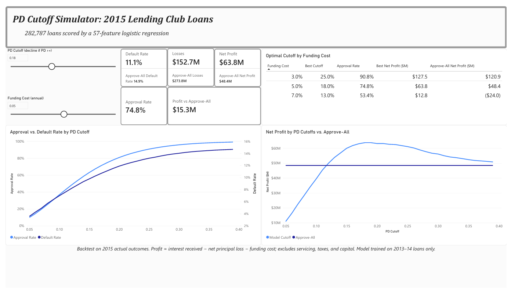
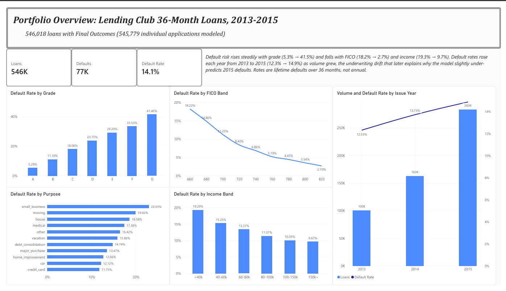
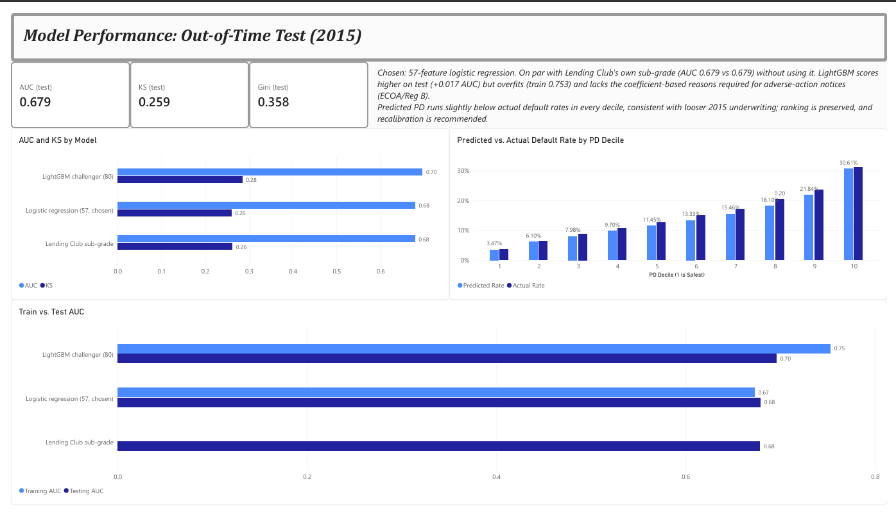
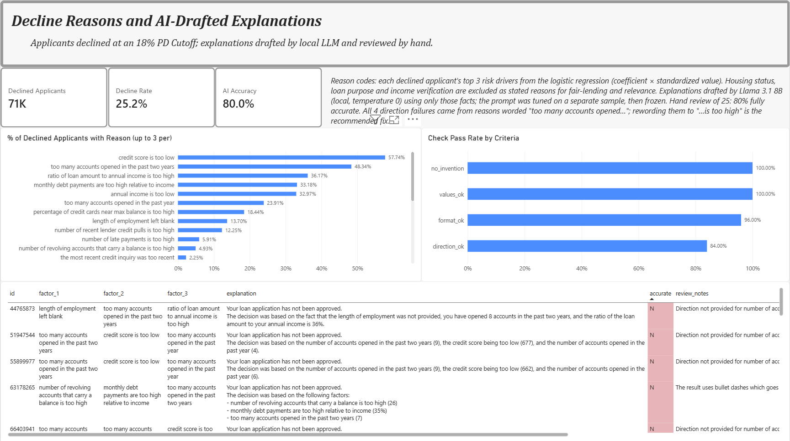

# Credit Risk Probability-of-Default Model

An end-to-end consumer credit risk project on **545,779 public Lending Club loans**: SQL, feature engineering based on data science principles, a validated logistic regression PD model, expected-loss and approval-cutoff economics, a Power BI decision dashboard, and LLM-drafted explanations reviewed by hand.

**Tools:** Python (pandas, NumPy, scikit-learn, statsmodels, LightGBM) · SQL (DuckDB) · Power BI (DAX, Power Query) · Ollama (Llama 3.1 8B, local) · Git



---

## Key results

| Area | Result |
|---|---|
| **Model** | Logistic regression, 57 features. Out-of-time test (2015): **AUC 0.679, Gini 0.358, KS 0.259**; train AUC 0.673 (no overfitting) |
| **Benchmark** | On par with Lending Club's own sub-grade (AUC 0.679, KS 0.262) without using it as an input |
| **Challenger** | LightGBM: test AUC 0.696 but train AUC 0.753 (overfitting); not chosen for stability and explainability |
| **Calibration** | Default rate rises in every risk decile, from 3.6% (safest) to 31.1% (riskiest), about 8.6x lift |
| **Expected loss** | LGD 0.506; 2015 expected loss $242.3M vs. actual $273.8M; gap traced to PD drift (~8%) and LGD drift (~3%) from looser 2015 underwriting |
| **Approval policy** | At a 5% funding cost, an **18% PD cutoff** approves 74.8% of applicants, lowers the default rate from 14.9% to 11.1%, **cuts losses 44%** ($273.8M to $152.7M) and **raises net profit 32%** ($48.4M to $63.8M) vs. approving everyone |
| **Sensitivity** | Optimal cutoff tightens as funding cost rises (3%: 25%, 5%: 18%, 7%: 13%); at 7%, approve-all loses $24.0M while the model cutoff earns $12.8M |
| **Decline reasons** | 71,287 applicants (25.2%) declined at the 18% cutoff, each with 3 model-driven reasons; top drivers: credit score, recent account openings, loan-to-income, DTI, income |
| **AI explanations** | Local LLM drafts 2-sentence decline explanations from structured facts only; hand review of 25: **80% fully accurate** (values 100%, no invented content 100%) |

*Profit figures are a backtest on actual 2015 outcomes: interest received minus net principal loss minus funding cost. They exclude servicing, taxes and capital.*

---

## Business question

A consumer lender has to decide **who to approve**. Approving everyone maximizes volume but lets in the riskiest borrowers; approving too few leaves profitable loans on the table. This project builds a probability-of-default (PD) model and turns it into an approval policy, then answers the follow-up questions a credit team would ask:

1. How well does the model rank risk on loans it has never seen?
2. How much would a model-based cutoff save in losses and add in profit?
3. How does the best cutoff change with the cost of funds?
4. Can every decline be explained with specific, compliant reasons?

---

## Approach

```
Raw data (2.26M loans, 151 columns)
  -> DuckDB: raw view -> typed table -> scoped view (36-month loans, 2013-2015, final outcome)
  -> SQL EDA (9 queries): default rate by grade, FICO, income, purpose, vintage
  -> Feature review: 38 post-origination leakage fields removed; geographic proxies excluded
  -> pandas cleaning: training-only imputation and scaling, engineered features
  -> Time split: train 2013-14 (262,992) / test 2015 (282,787)
  -> Logistic regression (80 -> 57 features after correlation + VIF pruning)
       vs. LightGBM challenger vs. Lending Club sub-grade benchmark
  -> Expected loss (PD x LGD x EAD) and PD-cutoff profit backtest with funding-cost sensitivity
  -> Reason codes (coefficient x standardized value) -> local LLM explanations -> human review
  -> Power BI dashboard (4 pages)
```

### 1. Data and SQL exploration
- Loaded the full Lending Club accepted-loans file (2,260,668 loans, 2007-2018) into a layered DuckDB database.
- Scoped to 36-month loans issued 2013-2015 so every loan has a final outcome (paid off or charged off).
- Wrote 9 SQL queries to profile default rates. Risk rises monotonically by grade (5.3% for A to 41.5% for G) and falls with FICO (18.2% in the 660s to 2.7% in the 820s).
- Found **underwriting drift**: default rates rose each year from 2013 to 2015 (12.3% to 14.9%), so the 2015 test set is riskier than the training data.

### 2. Leakage, fair lending and feature engineering
- Reviewed all 151 columns for leakage, fair-lending risk and sparsity (`docs/feature_review.csv`).
- Removed **38 post-origination fields** (payments, recoveries, settlement flags) that would not be known at application time.
- Excluded geographic fields (zip code, state) as potential proxies under ECOA/Reg B.
- Deliberately excluded Lending Club's own grade and interest rate, so the model is independent and the grade can serve as a benchmark.
- Imputed and scaled using **training-year statistics only**, and added 6 "ever had" flags where a blank means "never happened".
- Engineered credit-history length, log income, loan-to-income and average FICO.

### 3. Modeling and validation
- **Out-of-time split:** trained on 2013-14 and tested on 2015, which mirrors how a model is used in practice.
- Pruned 80 to 57 features using correlation (|r| > 0.8) and VIF (> 10) so coefficients are stable and their signs make business sense.
- Compared against a **LightGBM challenger** and **Lending Club's sub-grade**. Chose logistic regression: it matches the lender's own grade, does not overfit, and its coefficients produce the adverse-action reasons lenders are legally required to give.

### 4. Business translation
- Estimated LGD from training-year defaults (dollar-weighted) and expected loss for the 2015 portfolio.
- Explained the expected-loss shortfall: the model under-predicts 2015 defaults because 2015 underwriting was looser (a recalibration candidate).
- Backtested PD cutoffs from 5% to 40% with funding costs of 3%, 5% and 7%. Profit is nearly flat between 17% and 22% at a 5% funding cost, so the recommendation is robust and a growth-focused lender could approve more applicants at little cost.

### 5. Reason codes and AI-drafted explanations
- For each declined applicant, ranked each feature's contribution to the score (coefficient x standardized value) and kept the top 3 risk drivers. Rebuilt PDs from these contributions match the model to ~1e-15.
- Excluded housing status, loan purpose and income-verification status as stated reasons.
- A local LLM (Ollama, Llama 3.1 8B, temperature 0) writes a 2-sentence explanation using **only** those facts.
- Prompt tuned on one sample, then frozen and evaluated by hand on a separate random sample of 25 using a 4-part rubric:

| Check | Pass rate |
|---|---|
| Values correct | 100% |
| Nothing invented | 100% |
| Format valid | 96% |
| Direction stated ("too high" / "too low") | 84% |
| **Fully accurate** | **80%** |

All 4 direction failures came from one wording pattern ("too many accounts opened...") that the model rephrased without "too many". Rewording those reasons to "...is too high" is the recommended fix before any production use.

---

## Dashboard

Power BI report in `dashboard/` (`.pbix` plus a PDF export).

| Page | What it shows |
|---|---|
| Portfolio Overview | Default rates by grade, FICO, income, purpose and vintage |
| Model Performance | AUC/KS vs. benchmark and challenger, train vs. test AUC, calibration by decile |
| Cutoff Simulator | Sliders for PD cutoff and funding cost; live approval rate, default rate, losses and net profit vs. approve-all (DAX measures reconciled to the Python backtest) |
| Decline Reasons | Top decline drivers and the human review of LLM explanations |





---

## Limitations

- **Backtest, not a live test.** Outcomes are only observed for loans Lending Club approved, so the model has not been tested on applicants Lending Club declined (reject inference was out of scope).
- **Simplified profit.** Excludes servicing costs, taxes, capital and prepayment timing.
- **Single LGD.** One portfolio-level LGD is applied to every loan rather than a separate LGD model.
- **Calibration drift.** The model ranks 2015 risk well but under-predicts its level; it would be recalibrated before use.
- **Small AI review sample.** 25 explanations is enough to find failure patterns, not to certify accuracy.
- **Fair-lending review is a first pass.** Proxy variables were excluded, but no formal disparate-impact testing was done.

---

## Repository structure

```
credit-risk-pd-model/
├── sql/
│   ├── schema.sql             # DuckDB layers: raw view -> typed table -> scoped view
│   ├── eda_queries.sql        # 9 EDA queries
│   └── dashboard_extract.sql  # Loan-level extract for Power BI
├── src/
│   ├── download_data.py       # Kaggle download + row-count check
│   └── run_sql.py             # Builds the database and runs the EDA queries
├── notebooks/
│   ├── 02_cleaning.ipynb      # Feature selection, cleaning, engineering
│   ├── 03_model.ipynb         # Split, logistic regression, pruning, LightGBM, benchmark
│   ├── 04_business.ipynb      # LGD, expected loss, cutoff and funding-cost analysis
│   ├── 05_reason_codes.ipynb  # Reason codes, LLM explanations, review scoring
│   └── 06_dashboard_prep.ipynb# Runs the dashboard extract and reconciliation checks
├── outputs/                   # Metrics, cutoff tables, EDA results, reason-code review
├── dashboard/                 # Power BI report, PDF export, screenshots
├── docs/
│   ├── build_log.md           # Phase-by-phase log of what was done and found
│   ├── feature_list.md        # Final features and rationale
│   └── feature_review.csv     # Leakage / fair-lending review of all 151 columns
├── AI_USAGE.md                # Log of every AI contribution and what I verified
└── requirements.txt
```

---

## How to reproduce

Requires Python 3.12, a Kaggle API token and (for the explanations) Ollama.

```powershell
# 1. Environment
python -m venv .venv
.\.venv\Scripts\Activate.ps1
pip install -r requirements.txt

# 2. Data (downloads the Lending Club file from Kaggle)
python src/download_data.py

# 3. Build the DuckDB database and run the EDA queries
python src/run_sql.py

# 4. Run the notebooks in order: 02 -> 03 -> 04 -> 05 -> 06
#    (use Restart Kernel and Run All for each)

# 5. For notebook 05: install Ollama and pull the model
ollama pull llama3.1:8b
```

Open `dashboard/Credit_Risk_Model.pbix` in Power BI Desktop and refresh to load the outputs.

---

## Data

[Lending Club accepted loans, 2007-2018](https://www.kaggle.com/datasets/wordsforthewise/lending-club) via Kaggle. Public data only; no proprietary or employer data was used. Raw and processed data are not committed to the repository.

## How AI was used

I wrote all SQL queries and nearly all of the pandas, modeling and DAX code myself. Claude was used as a project manager and code reviewer, and wrote a small number of clearly marked cells (setup, the Ollama generation loop, review scoring). Every AI contribution, and what I verified, is logged in [`AI_USAGE.md`](AI_USAGE.md). AI also drafted this README for professionalism.

## Author

**Caleb Cort** · BBA Finance, University of Georgia (Terry College of Business), CS minor

[GitHub](https://github.com/CC1358952) · [LinkedIn](https://www.linkedin.com/in/caleb-cort/) · [Email](mailto:calebcort05@gmail.com)
